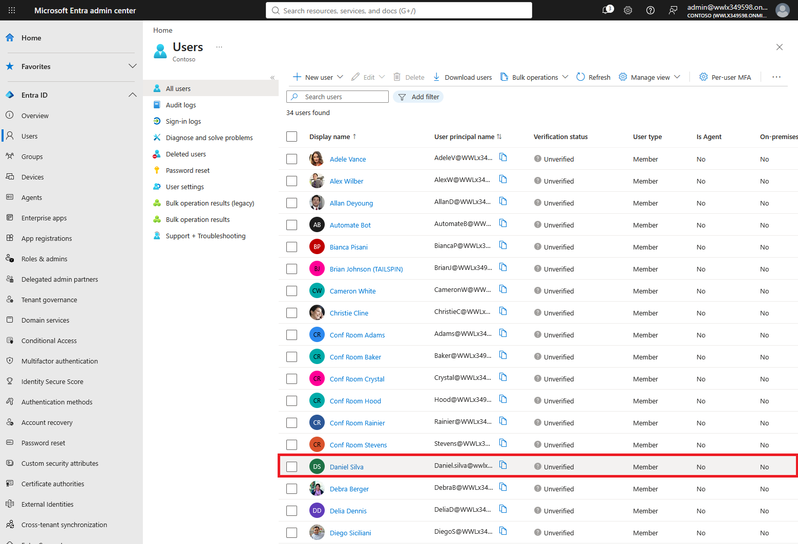
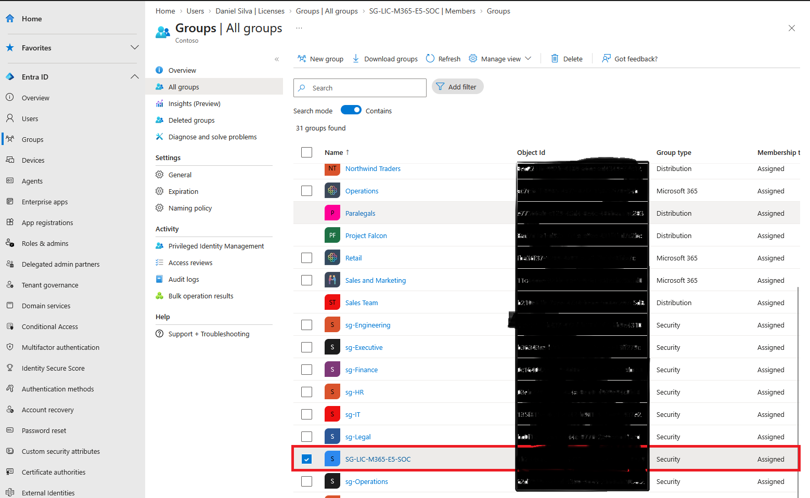

# Phase 1 — Employee Identity Provisioning

## Business Requirement

Contoso Professional Services needs to onboard Daniel Silva,
a new Cybersecurity Analyst in the Security Operations team.

The employee requires a centrally managed identity with
appropriate business attributes and secure authentication.

## Implementation

Platform: Microsoft Entra ID

Planned configuration:
- Display name: Daniel Silva
- Department: Security Operations
- Job title: Cybersecurity Analyst
- Office location: Melbourne
- Usage location: Australia
- User type: Member
- Account status: Enabled
- Password change required at first sign-in

## Security Considerations

- Use a fictional test identity.
- Require a password change at first sign-in.
- Avoid unnecessary administrative privileges.
- Apply group-based access in subsequent phases.
- Preserve sanitised audit evidence.

## Validation

Status: Pending verification

Checks:
- User exists in Microsoft Entra ID.
- Account is enabled.
- Business attributes are correct.
- Required password-change setting is configured.

## Evidence

Add screenshots after verification:

## Phase 2 — Group-Based Licence Management

### Business Requirement
Contoso requires centralised Microsoft 365 licence
management for Security Operations employees.

### Implementation
Created a Microsoft Entra security group:

- Group: SG-LIC-M365-E5-SOC
- Type: Security
- Membership: Assigned
- Intended licence: Microsoft 365 E5
- Test member: Daniel Silva

### Security Rationale
Group-based licensing simplifies onboarding,
reduces manual assignments and supports
consistent access lifecycle management.

### Validation
- Group created: Verify after implementation
- Daniel added: Verify in Members
- Licence assignment: Pending

### Licensing Limitation
At the time of testing, all 20 Microsoft 365 E5
licences were allocated.

Licence inheritance cannot be confirmed until
an available seat is obtained.

### Evidence
Sanitised group overview and membership screenshots.

## Evidence — Group-Based Licensing

### Screenshot 1: Licensing Group Overview

### Screenshot 2: Group Membership

