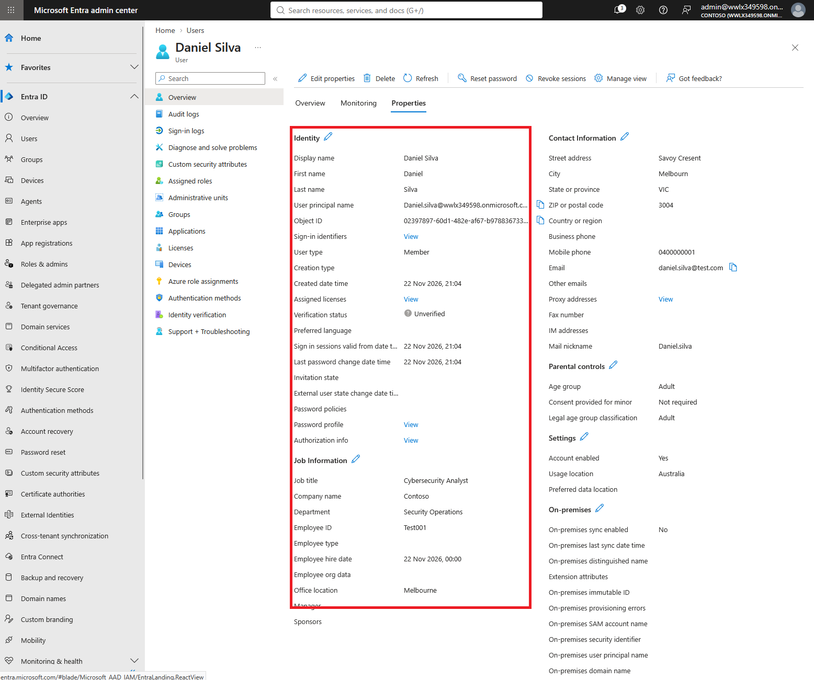
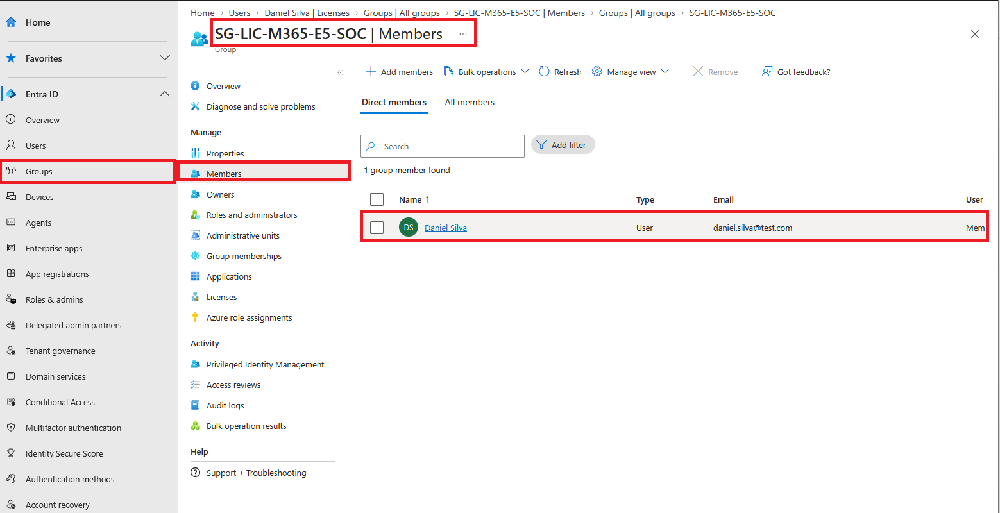
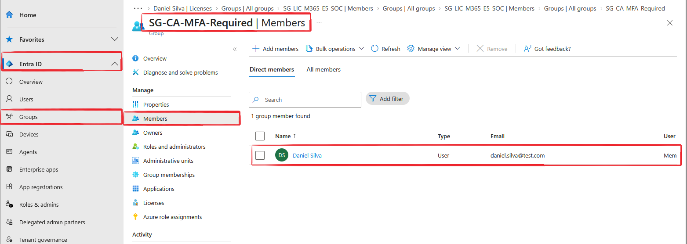
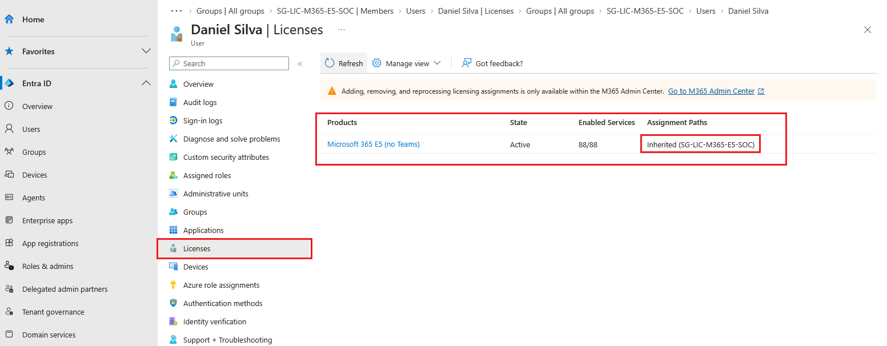

# Phase 1 — Employee Identity Provisioning

## Business Requirement

Contoso Professional Services needs to onboard Daniel Silva,
a new Cybersecurity Analyst in the Security Operations team.

The employee requires a centrally managed identity with
appropriate business attributes and secure authentication.

## Implementation

Platform: Microsoft Entra ID

Planned configuration:
- Display name: Daniel Silva
- Department: Security Operations
- Job title: Cybersecurity Analyst
- Office location: Melbourne
- Usage location: Australia
- User type: Member
- Account status: Enabled
- Password change required at first sign-in

## Security Considerations

- Use a fictional test identity.
- Require a password change at first sign-in.
- Avoid unnecessary administrative privileges.
- Apply group-based access in subsequent phases.
- Preserve sanitised audit evidence.

## Validation

Status: Pending verification

Checks:
- User exists in Microsoft Entra ID.
- Account is enabled.
- Business attributes are correct.
- Required password-change setting is configured.

## Evidence

Add screenshots after verification:

## Phase 2 — Group-Based Licence Management

### Business Requirement
Contoso requires centralised Microsoft 365 licence
management for Security Operations employees.

### Implementation
Created a Microsoft Entra security group:

- Group: SG-LIC-M365-E5-SOC
- Type: Security
- Membership: Assigned
- Intended licence: Microsoft 365 E5
- Test member: Daniel Silva

### Security Rationale
Group-based licensing simplifies onboarding,
reduces manual assignments and supports
consistent access lifecycle management.

### Validation
- Group created: Verify after implementation
- Daniel added: Verify in Members
- Licence assignment: Pending

### Licensing Limitation
At the time of testing, all 20 Microsoft 365 E5
licences were allocated.

Licence inheritance cannot be confirmed until
an available seat is obtained.

### Evidence
Sanitised group overview and membership screenshots.

## Evidence — Group-Based Licensing

### Screenshot 1: Licensing Group Overview

### Screenshot 2: Group Membership

# Phase 3 — MFA Security Group

## Business Requirement

Contoso Professional Services requires stronger
authentication controls for Security Operations
employees to reduce the risk of unauthorised access.

## Implementation

Platform: Microsoft Entra ID

Security group configuration:

- Group name: SG-CA-MFA-Required
- Group type: Security
- Membership type: Assigned
- Role assignable: No
- Test user: Daniel Silva

## Security Rationale

The group is designed to target authorised SOC users
with a future Conditional Access policy requiring MFA.

Using security groups supports centralised policy
targeting and simplifies identity access management.

## Validation

- Group creation: Pending verification
- Daniel Silva membership: Pending verification
- Conditional Access policy: Not yet configured
- MFA enforcement: Not yet tested

## Evidence

### MFA Security Group Overview

### Group Membership

## Next Steps

1. Verify Conditional Access licensing.
2. Confirm emergency-access account protection.
3. Create the MFA Conditional Access policy.
4. Configure report-only mode.
5. Validate policy targeting using the What If tool.
6. Review sign-in logs before enforcement.

# Phase 4 — Read-Only Security Access Group

## Business Scenario

Contoso Professional Services requires its SOC analysts
to view security dashboards and investigate security
events without unnecessary administrative permissions.

## Security Objective

Implement least-privilege access using Microsoft
Entra ID role-based access control (RBAC).

## Planned Implementation

- Group: SG-Security-ReadOnly-Access
- Group type: Security
- Membership type: Assigned
- Role assignable: Yes (subject to prerequisites)
- Intended member: Daniel Silva
- Intended role: Security Reader

## Security Rationale

Using a role-assignable security group supports
centralised management of administrative role
assignments and simplifies access reviews.

## Validation

- Group creation: Pending verification
- Role-assignable setting: Pending verification
- Daniel's membership: Pending verification
- Security Reader assignment: Not yet performed
- Read-only access testing: Pending

## Evidence

## Next Steps

1. Verify group creation and membership.
2. Assign the least-privileged Security Reader role.
3. Test successful read-only access.
4. Verify administrative changes are denied.
5. Review relevant audit logs.

## Group-Based Licensing — Validation

### Business Requirement
Provision Microsoft 365 E5 licensing to Daniel Silva
using centralised Microsoft Entra group membership.

### Implementation
- User: Daniel Silva
- Group: SG-LIC-M365-E5-SOC
- Product: Microsoft 365 E5 (no Teams)
- Assignment method: Group-based licensing

### Validation Results
- Licence state: Active
- Group-based inheritance: Verified
- Redundant direct assignment: [Record final result]
- Required services: [Record verification result]

### Security Outcome
Group-based licensing supports consistent
licence provisioning, centralised administration
and simplified employee offboarding.

### Evidence

